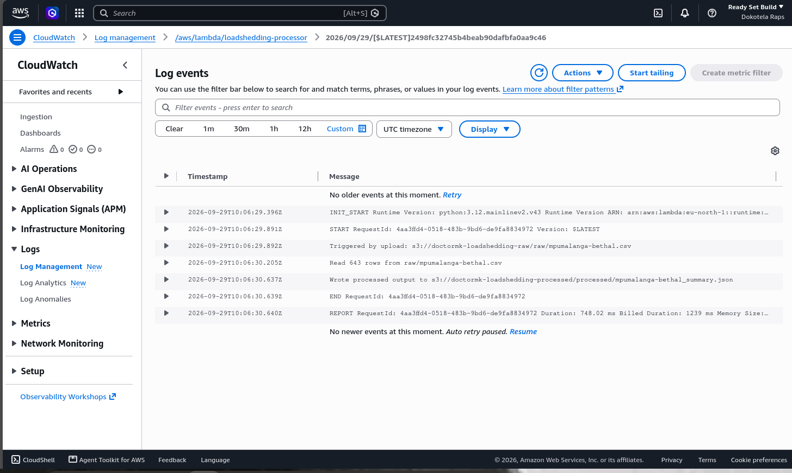
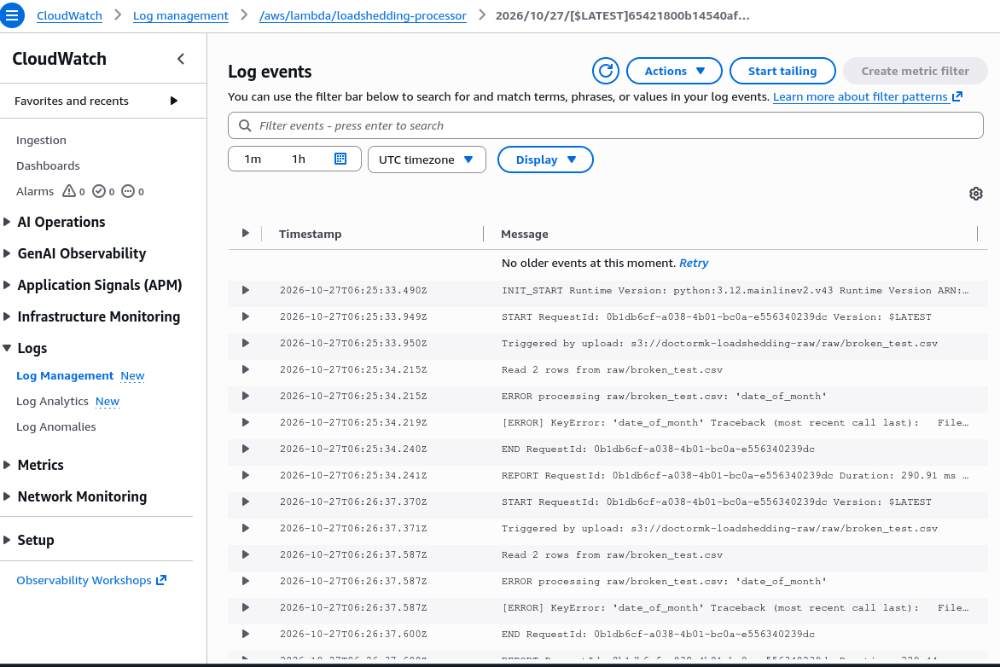

# Load Shedding Data Pipeline (S3 → Lambda → S3)

An event-driven AWS pipeline that turns a raw South African load shedding schedule into a clean summary. Upload a CSV to one S3 bucket and a Lambda function runs automatically, calculates the total outage hours per day for each stage, and writes the result as JSON to a second bucket. Every step is logged to CloudWatch.

Built as my Cloud Computing elective solo project.

**Demo video:** _add your unlisted YouTube link here_

## What problem it solves

Load shedding schedules are published as long lists of time windows per stage. That makes it hard to answer a simple question like "how many hours would I be without power on day 14 at Stage 6?". This pipeline answers it for any schedule file in the same format.

## Architecture

```
[CSV uploaded]
      |
      v
S3 raw bucket  (doctormk-loadshedding-raw, prefix raw/)
      |
      |  S3 "object created" event
      v
Lambda function  (loadshedding-processor, Python 3.12)
      |
      |------> CloudWatch Logs (execution trace and errors)
      v
S3 processed bucket  (doctormk-loadshedding-processed, prefix processed/)
```

All resources are in `eu-north-1`.

## How it works

1. A CSV is uploaded to `raw/` in the raw bucket.
2. S3 sends an event that invokes the Lambda function.
3. The function reads the file, parses each row, and works out the duration of every outage window.
4. Durations are added up per day and grouped by stage.
5. The result is written to the processed bucket as `<filename>_summary.json`.

Output shape:

```json
{
  "1": { "1": 2.5, "2": 2.5, "5": 5.0 },
  "2": { "...": "..." }
}
```

The outer key is the rotation day, the inner key is the stage, and the value is total outage hours.

## Input data

The input is a Bethal (Mpumalanga) schedule with these columns: `date_of_month, start_time, finsh_time, stage`.

- `date_of_month` is the area's position in the load shedding **rotation cycle** (1 to 31). It is not a calendar date.
- Times are `HH:MM` with no date. Some windows cross midnight (for example 23:00 to 01:30), so the duration calculation handles the wraparound.

## Repo structure

```
loadshedding-pipeline/
├── README.md
├── local/
│   └── loadshedding_transform.py    # transformation logic, tested locally first
├── lambda/
│   └── lambda_function.py           # the deployed Lambda handler
├── sample_data/
│   ├── mpumalanga-bethal.csv        # raw input
│   ├── mpumalanga-bethal_summary.json  # real output from the pipeline
│   └── broken_test.csv              # malformed file used for the error test
└── screenshots/                     # evidence of each step
```

## Build evidence

| # | Screenshot | What it shows |
|---|---|---|
| 1 | `01_s3_bucket_creation.png` | Creating the raw bucket |
| 2 | `02_raw_bucket_csv_uploaded.png` | The CSV in `raw/` |
| 3 | `03_lambda_function_created.png` | The Lambda function created |
| 4 | `04_iam_execution_role.png` | The execution role attached to the function |
| 5 | `05_iam_policy_created.png` | The scoped S3 policy I added |
| 6 | `06b_s3_trigger_config.png` | The S3 trigger on the raw bucket |
| 7 | `06_cloudwatch_log_group.png` | The log group created by the first run |
| 8 | `07_error_before_fix.png` | First run failing: missing `PROCESSED_BUCKET` environment variable |
| 9 | `08_successful_run.png` | A clean run: file read, 643 rows processed, output written |
| 10 | `09_processed_output_in_s3.png` | The summary JSON in the processed bucket |
| 11 | `10_malformed_file_rejected.png` | A malformed CSV rejected with an error |



## Problems I hit and fixed

- **Missing environment variable.** The first run failed with `KeyError: 'PROCESSED_BUCKET'`. I had not set the variable in the Lambda configuration. After adding it, the next upload succeeded.
- **Data format.** I first planned around a different CSV format. I checked the real file before deploying and rewrote the transformation for the rotation-day format.

## Error handling

When a CSV has the wrong columns, the function logs the error to CloudWatch and fails, and nothing is written to the processed bucket. Bad input never produces a bad output file.



## IAM and permissions

The AWS classroom account gave the function a broad `PowerUserRole`. On top of that I attached an inline policy that limits the function to what it needs: read from the raw bucket and write to the processed bucket. In a normal account I would use only that scoped policy, with no broad role.

```json
{
  "Version": "2012-10-17",
  "Statement": [
    { "Effect": "Allow", "Action": ["s3:GetObject"],
      "Resource": "arn:aws:s3:::doctormk-loadshedding-raw/*" },
    { "Effect": "Allow", "Action": ["s3:PutObject"],
      "Resource": "arn:aws:s3:::doctormk-loadshedding-processed/*" }
  ]
}
```

## Limitations and next steps

- Failed files stay in the raw bucket. A next step would be moving them to a `failed/` prefix.
- The function only reads the first record of each S3 event, which is enough for single-file uploads.
- Column validation could give a clearer message than a raw `KeyError`.
- Summaries for several areas could be combined into one report.